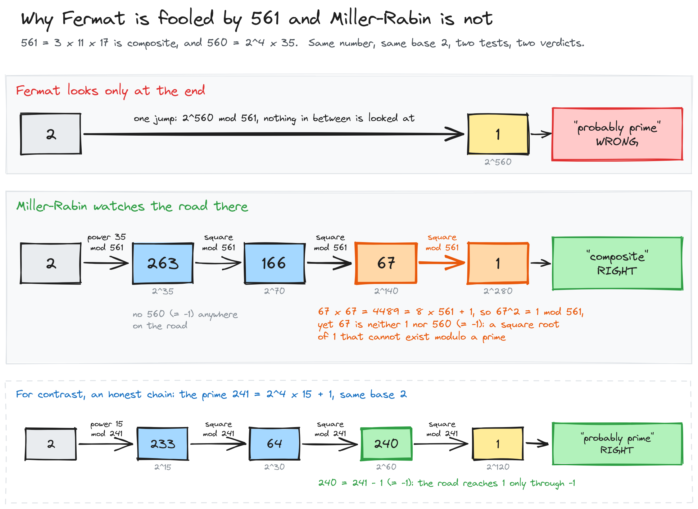
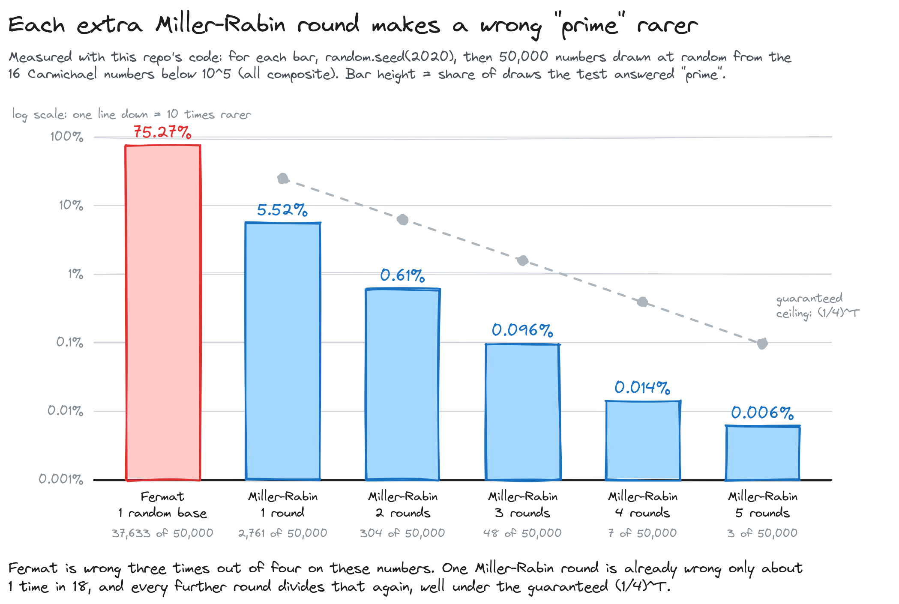
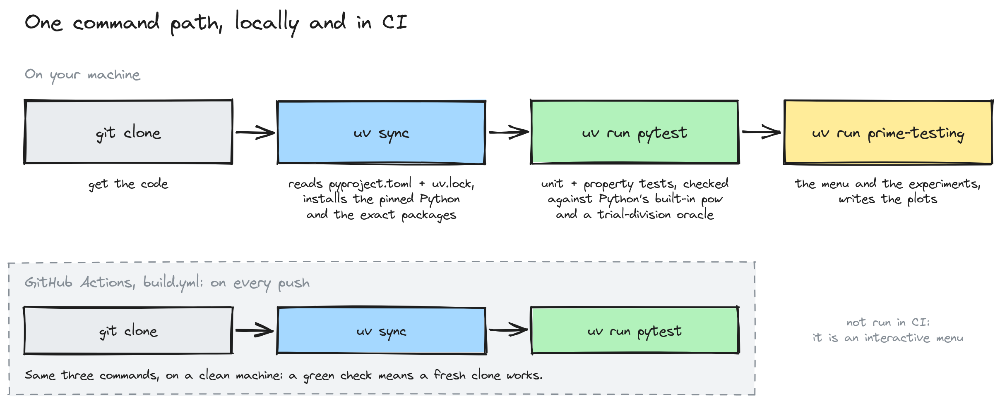

# Primality testing, from trial division to Miller-Rabin

Is this 300-digit number prime? Dividing by every candidate would outlast the universe, so real systems ask a faster question that is allowed to be wrong, then make "wrong" vanishingly rare. I built the whole chain from scratch in Python: Euclid, fast modular exponentiation, the Fermat test, the numbers that break it, the Miller-Rabin test that fixes it, and an RSA key generator on top.

[](https://github.com/mbenimam/primality-testing/actions/workflows/build.yml)




## At a glance

| | |
| --- | --- |
| **What** | Three primality tests and the arithmetic under them, written without any number-theory library, plus the experiments that measure how often each test is wrong |
| **For** | A first-year Master's course at Sorbonne Université (COMPLEX, 4I900), done in a pair with Guillaume Magniadas |
| **Stack** | Python 3.14, standard library for the algorithms, matplotlib and seaborn for the plots, pytest, uv |
| **Result** | On Carmichael numbers the Fermat test answers "prime" 75.27% of the time; Miller-Rabin does it 5.52% of the time with one round and 0.006% with five (50,000 draws each) |
| **Read next** | [The original report, in French](docs/report/rapport_Benimam_Magniadas.pdf) |

## What the project is

A primality test takes an integer N and answers one question: is N prime? The question matters because RSA keys are made of two large primes, so generating a key means finding primes of a thousand bits, quickly.

There are two ways to answer. A **deterministic** test is always right, and the simple one, trial division, tries every divisor up to √N. A **probabilistic** test picks a random number, runs a cheap check, and answers either "composite, for certain" or "probably prime". It never calls a prime composite, but it can call a composite prime.

The project asks how good that trade is. How much faster is the probabilistic test, how often is it wrong, on which numbers, and what does it cost to push the error down?

## Words used in this README

- **Prime**: an integer above 1 whose only divisors are 1 and itself. Anything else above 1 is **composite**.
- **a mod N**: the remainder of a divided by N. Arithmetic "modulo N" keeps only remainders.
- **gcd**: the greatest common divisor of two integers. Two numbers are **coprime** when their gcd is 1.
- **Modular inverse**: the inverse of a modulo N is the b with a·b mod N = 1. It exists exactly when a and N are coprime.
- **Base** (or witness): the random number a that a probabilistic test raises to a power.
- **Liar**: a base that makes a test answer "probably prime" for a composite number.
- **Carmichael number**: a composite number for which every base coprime to it is a liar for the Fermat test. The smallest is 561 = 3 × 11 × 17.
- **Round**: one run of a probabilistic test with a fresh random base.
- **Bit length**: the number of binary digits of N. A 1024-bit number is around 10^308.

## How it works

### The tool everything stands on: fast modular exponentiation

Every test below computes a^n mod N with n as large as N itself. Multiplying a by itself n times is hopeless, so [`my_expo_mod`](src/prime_testing/arithmetic.py) reads the exponent bit by bit: square at every bit, multiply by a when the bit is 1. That is about log₂(n) squarings, so a 1024-bit exponent costs about a thousand steps, not 2^1024.

### Fermat: fast, and fooled

Fermat's little theorem says that if N is prime, then a^(N−1) mod N = 1 for every a between 1 and N−1. The Fermat test turns it around: pick a, compute a^(N−1) mod N, and answer "composite" if the result is not 1.

The catch is the other direction. Take N = 561 and a = 2: 2^560 mod 561 = 1, so the test answers "probably prime", and 561 is 3 × 11 × 17. It is not bad luck with the base either: 319 of the 559 bases from 2 to 560 give the same wrong answer. 561 is a Carmichael number, and for those, repeating the Fermat test barely helps.

### Miller-Rabin: watch the road, not only the end

Miller-Rabin uses one more fact about primes: modulo a prime, the only square roots of 1 are 1 and −1.

Write N − 1 = 2^h × m with m odd. For 561 that is 560 = 2^4 × 35. Instead of jumping straight to a^(N−1), compute a^m and square it step by step. With a = 2:

| Power | 2^35 | 2^70 | 2^140 | 2^280 |
| --- | --- | --- | --- | --- |
| mod 561 | 263 | 166 | 67 | 1 |

The chain reaches 1 coming from 67, and 67 is neither 1 nor 560 (which is −1 modulo 561). So 67 is a third square root of 1, which no prime allows: 561 is composite, for certain. The picture at the top shows this chain next to the honest one for the prime 241, which reaches 1 only by passing through 240 = −1.

For any composite N, at most a quarter of the bases are liars, so T rounds leave an error of at most (1/4)^T. [`test_miller_rabin`](src/prime_testing/primality.py) does at most h − 1 squarings per round.

### What I measured



Each bar is 50,000 draws from the 16 Carmichael numbers below 10^5, with `random.seed(2020)`. The four- and five-round bars rest on 7 and 3 wrong answers, so read them as "rare", not as precise rates. The measured error sits well under the (1/4)^T guarantee.

Carmichael numbers are the worst case. On 50,000 random odd composites below 10^5, one Fermat round was wrong 189 times (0.38%) and one Miller-Rabin round 42 times (0.08%).

### Which test, and when

| Test | Cost for a b-bit number | Can it be wrong? | Use it when |
| --- | --- | --- | --- |
| Trial division, `first_test` | up to √N divisions, so about 2^(b/2): exponential in b | Never | N is small, or you need a reference to check the others against |
| Fermat, `test_fermat` | one modular exponentiation per round, about b squarings | Yes, and on Carmichael numbers more rounds do not fix it | Teaching, or as a quick first filter |
| Miller-Rabin, `test_miller_rabin` | one modular exponentiation per round, the same order as Fermat | Yes, at most (1/4)^T after T rounds, on every composite | Large N: this is the one RSA key generation uses here |

Trial division is the oracle in my tests and in the experiments; it counts the 9,592 primes below 10^5. Miller-Rabin costs the same order as Fermat and closes its blind spot, which is why Fermat is here to be measured and not to be used. On this machine, `test_miller_rabin(2**521 - 1)` confirms a 157-digit prime in about 11 ms with ten rounds, a number trial division could never finish.

### From primes to RSA

[`gen_rsa`](src/prime_testing/rsa.py) draws random t-bit odd numbers until Miller-Rabin accepts two of them, p and q. `RSA` then picks a public exponent e coprime to (p−1)(q−1) and computes the private exponent d as its modular inverse with the extended Euclidean algorithm. One run with two 1024-bit primes took 1.7 s to generate a 2048-bit key, and encrypting then decrypting "Bonjour" took 0.3 s.

## What is in the repo

| Module | What it holds |
| --- | --- |
| [`arithmetic.py`](src/prime_testing/arithmetic.py) | gcd, extended gcd (Bézout coefficients), modular inverse by brute force and by Bézout, fast modular exponentiation |
| [`primality.py`](src/prime_testing/primality.py) | trial division, Fermat, Miller-Rabin, Korselt's criterion and two Carmichael generators |
| [`rsa.py`](src/prime_testing/rsa.py) | prime generation, key pair, encode and decode |
| [`experiments.py`](src/prime_testing/experiments.py) | timing curves and error-rate measurements, drawn with [`plotting.py`](src/prime_testing/plotting.py) |
| [`cli.py`](src/prime_testing/cli.py) | the interactive menu that runs any of the above |

## Quick start

Prerequisite: [uv](https://docs.astral.sh/uv/). It installs the pinned Python and the locked packages.

```bash
git clone https://github.com/mbenimam/primality-testing.git
cd primality-testing
uv sync
uv run pytest          # 36 checks, about 2 seconds
uv run prime-testing   # interactive menu (in French): calculators and experiments
```

Experiments save their plots to `plots/`. Set `PRIME_TESTING_PLOTS` to write them elsewhere.

From Python:

```python
from prime_testing.primality import first_test, test_fermat, test_miller_rabin

first_test(561)           # False: trial division is always right
test_fermat(561, 2)       # True: base 2 is a liar
test_miller_rabin(561)    # False
test_miller_rabin(2**521 - 1)   # True
```



## Tests

The 36 pytest checks compare each function with an independent reference: Python's built-in `pow` and `math.gcd` for the arithmetic, and a separate trial-division oracle for the primality tests. Miller-Rabin is checked against that oracle on every odd number from 5 to 20,000, on all 16 Carmichael numbers below 10^5, and on a few large known values such as 2^127 − 1.

## Limits

- **The RSA here is a demonstration.** It encrypts one character at a time with no padding, so equal letters give equal ciphertexts. Do not protect anything with it.
- **Finding Carmichael numbers is slow.** `isCarmichael` tries every base below n, which is fine up to 10^5 and not much further. The random generator only builds Carmichael numbers with three prime factors.
- **The slow experiments are slow on purpose.** The brute-force inverse and trial division are there to be timed against the fast versions, so some menu entries run for minutes.
- **Random bases come from Python's `random` module**, which is not a cryptographic source.
